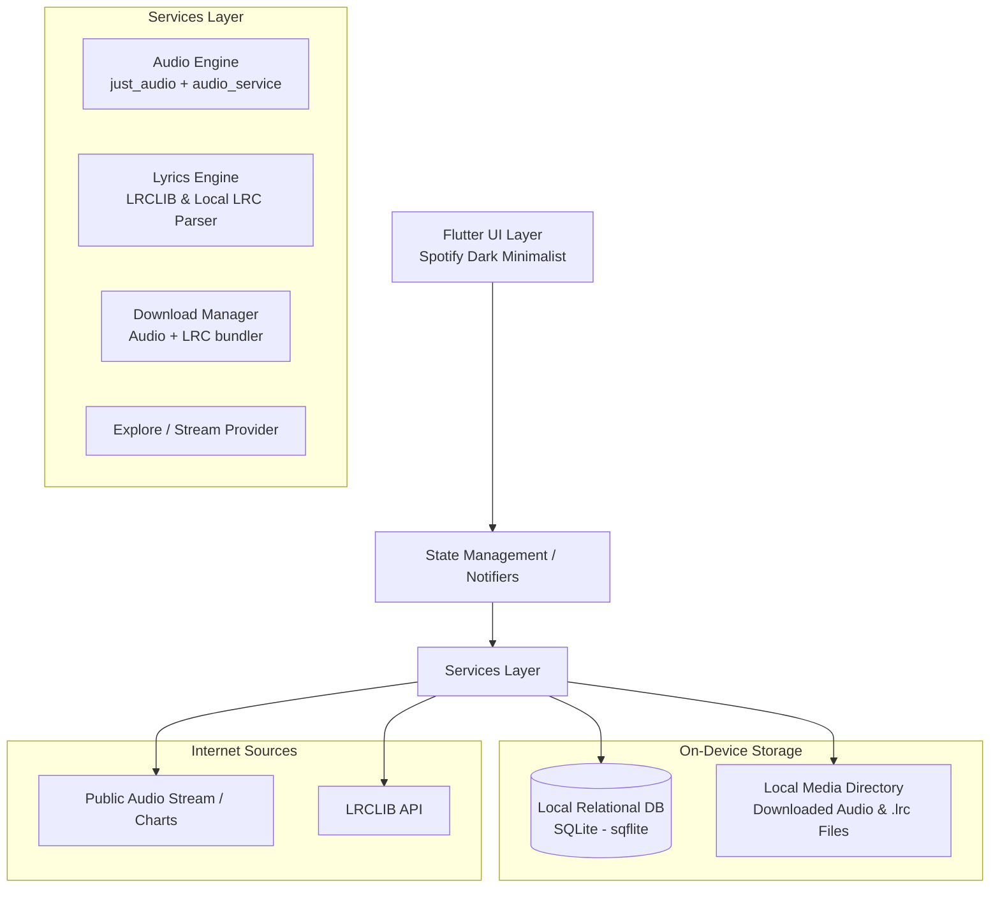

# ARCHITECTURE: ispotipay

> Source of truth for system structure, layers, and data flow.
> Every developer and agent must follow these patterns. Update this file before making architectural changes.

---

## 1. System Overview

`ispotipay` is a local-first, offline-capable music player built on **Flutter**. It interacts with public audio streaming sources and lyrics providers, and stores metadata, preferences, history, and audio files locally on the device.



---

## 2. Layer Separation & Responsibilities

1. **Presentation / UI (`lib/ui/` or `lib/presentation/`):**
   - Screens: Home (Trending/Charts), Search, Player/Lyrics Screen, Library (Favorites, Recents, Downloads).
   - Reusable widgets (PlayerBar, SongTile, LyricsViewer).
   - **Performance & Low-End Optimization Rules:**
     - **Infinite Scroll / Pagination:** Fetch 25 items on first load; automatically load the next batch of 25 when the user reaches the bottom of the list. Never fetch full datasets into memory.
     - **Search Debounce (400ms):** User search input must be debounced with a 400ms timer to cancel pending queries while typing, saving network calls, battery, and CPU cycles.
     - **Render Budget:** Avoid heavy blur (`BackdropFilter`) and continuous unthrottled widget rebuilds. Keep widget trees flat and use `const` constructors aggressively.
2. **State Management (`lib/logic/` or `lib/providers/`):**
   - Player State (current track, duration, position, buffering, play/pause/shuffle/repeat).
   - Lyrics State (current line index based on position milliseconds).
   - Library State (favorites, recents, offline tracks).
3. **Core Services (`lib/services/`):**
   - `AudioPlayerService`: Wraps audio playback, lock screen notification integration, audio session handling.
   - `LyricsService`: Fetches synced LRC from online API or reads local `.lrc` file; parses timestamps `[mm:ss.xx]`.
   - `DownloadService`: Downloads stream bytes to device storage and saves accompanied lyrics.
   - `StorageService`: Manages local DB for Favorites, Recents, and Download index.

---

## 3. Data Flow & Offline Strategy

### Streaming Flow:
1. User searches track $\rightarrow$ Search Service returns track metadata.
2. Track tapped $\rightarrow$ Audio Service resolves audio stream URL.
3. Lyrics Service fetches synced LRC from LRCLIB.
4. Storage Service automatically updates **Recents** list in local database.

### Offline Download Flow:
1. User taps "Download" on track.
2. Download Service downloads audio stream to app documents directory: `<app_data>/tracks/<song_id>.m4a`.
3. Download Service fetches the LRC lyrics and saves companion file: `<app_data>/lyrics/<song_id>.lrc`.
4. Metadata is saved to Local DB under `downloaded_tracks`.

### Offline Playback Flow:
1. When user plays a downloaded track, audio player opens local file path directly.
2. Lyrics viewer reads local `<song_id>.lrc` file directly $\rightarrow$ **Full synced lyrics with zero internet required.**

---

## 4. Local-First Storage Schema (SQLite)

All private listening data is kept strictly on-device using structured SQLite tables:

### 1. `favorites` table:
```sql
CREATE TABLE favorites (
  id TEXT PRIMARY KEY,
  title TEXT NOT NULL,
  artist TEXT NOT NULL,
  album TEXT,
  duration_ms INTEGER NOT NULL,
  thumbnail_url TEXT,
  created_at INTEGER NOT NULL
);
```

### 2. `recents` table (Capped at 100 items via trigger/query):
```sql
CREATE TABLE recents (
  id TEXT PRIMARY KEY,
  title TEXT NOT NULL,
  artist TEXT NOT NULL,
  album TEXT,
  duration_ms INTEGER NOT NULL,
  thumbnail_url TEXT,
  played_at INTEGER NOT NULL
);
```

### 3. `downloads` table:
```sql
CREATE TABLE downloads (
  id TEXT PRIMARY KEY,
  title TEXT NOT NULL,
  artist TEXT NOT NULL,
  album TEXT,
  duration_ms INTEGER NOT NULL,
  thumbnail_url TEXT,
  audio_path TEXT NOT NULL,
  lyrics_path TEXT,
  downloaded_at INTEGER NOT NULL
);
```
